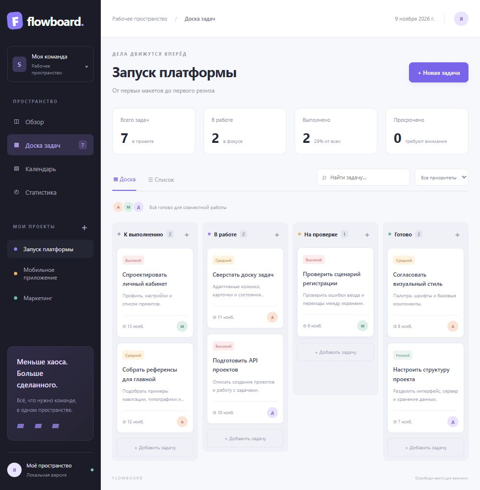

# FlowBoard

Сервис управления проектами и задачами. Я сделал его, чтобы держать проекты, сроки и текущую работу в одном месте.



В основе — канбан-доска с четырьмя статусами. Карточки можно перетаскивать мышью, а на телефоне — открывать и менять статус в форме. Данные сохраняются на сервере в SQLite и остаются после перезапуска.

## Что работает

- Создание проектов и задач.
- Редактирование описания, исполнителя, приоритета и срока.
- Доска и табличный список задач.
- Поиск по названию, описанию и исполнителю, фильтр приоритетов.
- Расписание задач по срокам и отметки просроченных задач.
- Статистика по статусам и загрузке участников.
- Лента изменений и адаптивный интерфейс.

## Запуск

Нужен Python 3.11 или новее. Сторонних библиотек нет.

```bash
python server.py
```

Открыть [localhost:8000](http://localhost:8000). При первом запуске появятся три демонстрационных проекта. База создаётся в `data/flowboard.db`.

На Windows также можно запустить `start.bat`.

## Docker

```bash
docker compose up --build -d
```

Приложение доступно на [localhost:8000](http://localhost:8000). База хранится в отдельном томе `flowboard_data`.

```bash
docker compose down
```

Эта команда останавливает контейнер и сохраняет данные. Удаление тома приведёт к удалению базы.

## Проверки

```bash
python -m unittest discover -s tests -v
node --check web/app.js
```

Тесты проверяют создание, изменение, удаление и сохранение задач, валидацию, HTTP API и раздачу интерфейса. Они используют временные базы и не меняют рабочие данные.

## Структура

```text
flowboard/
├── flowboard/
│   ├── schema.sql        # таблицы и индексы
│   └── store.py          # валидация и работа с SQLite
├── web/
│   ├── index.html        # интерфейс
│   ├── style.css         # стили и адаптивная вёрстка
│   └── app.js            # доска, формы, фильтры и графики
├── tests/test_app.py     # тесты хранилища и HTTP
├── docs/
│   ├── API.md
│   └── ARCHITECTURE.md
├── server.py
├── Dockerfile
└── compose.yaml
```

## Настройки

| Переменная | По умолчанию | Назначение |
| --- | --- | --- |
| `HOST` | `127.0.0.1` | Адрес сервера |
| `PORT` | `8000` | Порт |
| `FLOWBOARD_DB` | `data/flowboard.db` | Путь к базе |

## Границы версии

Я сделал эту версию для локальной работы и демонстрации проекта. Здесь нет регистрации, ролей, разграничения доступа, загрузки файлов, комментариев и уведомлений. Имя исполнителя задаётся текстом, без учётной записи. Не стоит открывать сервер в интернете до добавления авторизации и настройки защищённого развёртывания. Встроенный HTTP-сервер рассчитан на локальный запуск.

Следующие шаги: учётные записи, приглашения в команду, комментарии и история отдельной задачи.

Подробнее: [API](docs/API.md) · [Устройство проекта](docs/ARCHITECTURE.md) · [Участие в разработке](CONTRIBUTING.md).
