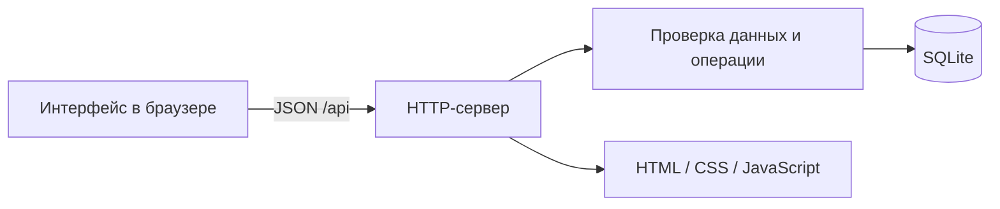

# Устройство проекта

Я оставил стек небольшим: Python, SQLite и обычный JavaScript. Проект запускается без установки зависимостей, а интерфейс не требует сборки.

`server.py` отвечает за маршруты, JSON и HTTP-коды. `flowboard/store.py` проверяет данные и выполняет параметризованные SQL-запросы. Для каждой операции открывается отдельное соединение; изменения задачи и запись события выполняются в одной транзакции. Внешние ключи включаются при каждом соединении.

Интерфейс получает состояние через `/api/state`. После успешного изменения он повторно загружает данные. Сервер остаётся источником актуального состояния. Значения пользователя экранируются перед вставкой в HTML.

Проект содержит три таблицы: `projects`, `tasks`, `activity`. Индекс по проекту и статусу подготовлен для выборок задач. Инициализация создаёт демонстрационные данные только при отсутствии проектов.

Текущая версия рассчитана на небольшой объём задач: API отдаёт их одним ответом. Для больших команд понадобятся постраничные выборки, авторизация, роли и управление конкурентным редактированием. Сейчас при одновременном изменении одного поля сохраняется последнее значение.

Для резервной копии нужно остановить приложение и скопировать файл базы. Чтобы восстановить данные, следует вернуть копию по пути `FLOWBOARD_DB` перед запуском.
